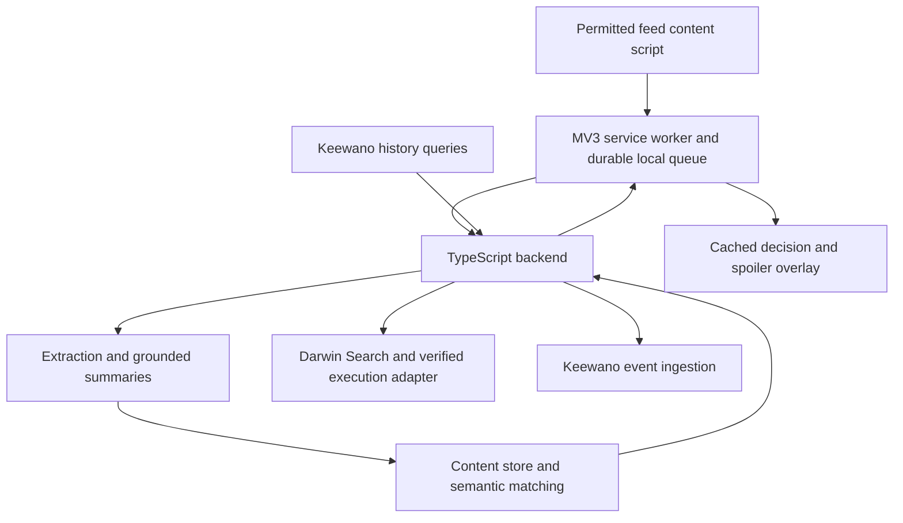

# SpoilerScroll design plan

Status: proposed MVP design, October 11, 2026. Based on the web conversation supplied by the user. No implementation or live integration has been completed.

## Product

“Social media makes the next post feel new. SpoilerScroll remembers what you have already consumed and spoils repetitive content before you click.”

Build a Chrome extension that recognizes repeated information during sustained feed browsing, then offers a grounded spoiler. The user always controls whether to keep reading. Treat browsing patterns as signals, not a psychological diagnosis.

The user's direction establishes Chrome, content summaries, Keewano history, Darwin extractor discovery, and remembering the agent used. The specific site, thresholds, stack, and visual choices below are proposals.

## MVP scope

- One text-heavy public feed: Reddit proposed, with a controlled local feed using the same extraction interface for a reliable demo.
- Explicit enablement per supported site; pause and clear-history controls.
- Visible-content extraction, brief summaries, claim-level repetition matching, and a click-time spoiler.
- Keewano stores behavioral sequences and extractor outcomes; live history queries affect product decisions.
- Darwin discovers extractors when the local adapter is insufficient. Reuse a verified successful extractor based on Keewano history.
- External execution is an integration milestone: discovery alone must never be shown as successful crawling.

Defer video/audio understanding, universal site support, accounts, a dedicated analytics dashboard, and automatic execution of arbitrary discovered agents.

## User journey and surfaces

1. Open the extension popup. Explain supported-site monitoring, remote processing, and stored data before enabling it.
2. Browse normally. Cards qualify as viewed only after meaningful visible dwell in an active tab. Visibility is a proxy for exposure, not proof of reading.
3. Extract and summarize qualified content once. Prepare nearby candidate cards in the background with bounded concurrency; do not count previews as consumed.
4. Compare a candidate's claims with previously viewed items and evaluate the browsing sequence.
5. A qualifying card receives a subtle “Similar to 3 posts you viewed” badge. On a normal click, show a compact spoiler anchored to that card.
6. Offer “Skip this,” “Read anyway,” and “This adds something new.” Include “Pause spoilers” and an expandable explanation with prior sources.
7. Popup shows observed repeats, explicit skips, and read-anyway actions for the session.

Illustrative overlay, only when supported by extracted evidence:

> Similar to 3 posts you viewed
>
> Spoiler: This preview repeats the claim that AI will change programming tasks. We could only read the preview.
>
> [Skip this] [Read anyway] [This adds something new]
>
> Why this appeared · Pause spoilers

“Skip this” closes the overlay without navigation. “Read anyway” follows the original destination once, without retriggering. An unclassified click navigates normally. Preserve modified clicks, middle clicks, downloads, and new-tab intent in the MVP; interception coverage is limited to tested normal activations, including keyboard activation.

### Visual direction

A calm, compact utility: warm neutral background, charcoal text, muted amber repetition indicator, teal primary action. Avoid alarming scores or guilt language. Use system typography and generous spacing. Scope overlay styles with Shadow DOM. Support visible keyboard focus, Escape dismissal, focus restoration, screen readers, and reduced motion. Avoid moving the page layout. Popup fits approximately 360px width; overlay remains usable in narrow windows.

## Detection and grounding

Initial tunable hypotheses, not validated behavioral thresholds:

| Signal | Proposed starting rule |
| --- | --- |
| Viewed item | At least 50% visible for 3 seconds while tab is active |
| Session boundary | 10 minutes without activity |
| Repeated information | At least 3 prior viewed items with overlapping claims in a 15-minute window |
| Sustained browsing | At least 5 active minutes plus repeated feed progression |
| Intervention frequency | At most once per item, 60-second cooldown |

Require both a browsing-pattern gate and sufficiently supported claim repetition. Topic similarity retrieves candidates; it does not by itself justify an intervention. New facts, dates, evidence, or opposing conclusions reduce repetition confidence. Tune similarity cutoffs using labeled fixtures before choosing numerical scores. The demo may explicitly enable a labeled short-session mode rather than silently changing these thresholds.

Summaries contain source ID, extracted evidence spans, main claims, extraction scope (preview/full text), and model version. Do not claim that an article adds nothing when only its preview is available. A preview-only match uses preview-only wording. Missing evidence, uncertain extraction, and incomplete classification produce no spoiler.

Never wait on a crawler or LLM inside the click handler. Cache prepared decisions; stale responses must not attach to recycled feed cards. Treat extracted content as untrusted data rather than model instructions.

## Architecture

Proposed stack: TypeScript throughout, Manifest V3 extension bundled with Vite, small Node backend, SQLite for hackathon content records, and backend LLM summarization/embeddings. Keep provider choice configurable. React is optional for the popup; it is unnecessary for feed observation.

The content script observes permitted DOM via IntersectionObserver and MutationObserver, deduplicates stable card IDs, and extracts through a site adapter. The service worker coordinates messages and persists queues/cache in extension storage so suspension does not lose work. The backend owns credentials, extraction validation, similarity, and integrations. No sponsor keys or personal access tokens ship in the extension.

Use Keewano as authoritative behavioral history. Hydrate a local working cache from queried history, then merge pending events by event ID to cover ingestion delay. A degraded session may continue from existing cached evidence, but show that history is unavailable; it is not a successful live-integration demo.

## Data boundaries

| Store | Contents |
| --- | --- |
| Extension local storage | Opt-in sites, sensitivity, install UUID, pending events, recent decision cache |
| Backend content store | Content ID, canonical public URL, scoped evidence, full summary, claims, embeddings, extraction provenance |
| Keewano | Ordered typed exposure, click, repetition, intervention, feedback, and extraction events; content/summary/agent references |

Correction to the earlier conversation: Keewano is not the proposed full-text summary database. Its hackathon guide caps event strings at 256 characters and directs raw text elsewhere under an ID. Store summaries externally and retain their references in Keewano. Do not serialize arbitrary objects into string events.

## Keewano integration

Verified documentation:

- Ingestion: `POST https://api.keewano.com/event/ingress/v1/json/in`, using an SDK-type project key in the `k-token` header.
- Register custom event IDs >= 2000 through `/event/ingress/v1/json/custom`; include the registered map hash and custom data types in batches.
- Use an anonymous install UUID, UUID dataSessionId, chronological events, and incrementing batch numbers. Retry the same persisted batch unchanged; verify accepted counts as well as HTTP status.
- Ingestion is asynchronous. The hackathon guide advises allowing about five minutes for query visibility. Verify actual lag before the demo.
- Read access uses a separate personal access token through SQL or MCP. SQL is a restricted PostgreSQL-compatible surface, not a general relational database.

Proposed append-only event catalog: ContentContext(string ID), SummaryContext(string ID), SiteContext(string), TopicContext(string), ExtractionScope(string), AgentContext(string), CapabilityContext(string), RevisionContext(string), ExtractionAttemptContext(string), ContentViewed(none), DwellSeconds(uint), NavigationOpened(none), ExtractionCompleted(bool), ExtractionLatencyMs(uint), ExtractionQualityPercent(uint), RepeatDetected(none), SpoilerShown(none), SpoilerSkipped(none), ReadAnyway(none), FalsePositiveReported(none), SessionEnded(none).

Register exact numeric IDs during implementation. Write explicit context before each outcome. Serialize context/outcome groups per install so concurrent jobs cannot interleave and inherit another item's agent or content. Clear optional context explicitly when it does not apply. Preserve exact Darwin identifiers; validate identifier lengths against the string limit and use a content-store reference if necessary.

### Queries that change behavior

1. Before extraction, query successful attempts for the site's content type, capability revision, quality, and latency. Prefer a verified compatible extractor; invalidate cached selections on failures or changed requirements. Fall back to local extraction or Darwin discovery when no suitable method exists.
2. Query the install's recent viewed content IDs and sequence to hydrate the matching window. Use those IDs to retrieve summaries externally. Pending local exposures augment the query until ingestion catches up.
3. Query intervention outcomes for an explanation of what happened. Report explicit skips separately from ordinary non-clicks.

At least one live query must visibly alter a choice during the demo. Persist query result provenance and timestamps with decisions. Validate exact SQL/Lua queries and access before implementation relies on them.

## Darwin extraction lifecycle

Local DOM adapter → known successful compatible extractor from Keewano → Darwin Search → route/setup verification → supported execution → evidence validation → record outcome.

Search accepts capability descriptions and returns stable agent/capability identifiers plus readiness/setup information. Preserve the exact revision when supplied; do not invent one when absent. Search does not execute the provider. Managed execution requires separate authority and a currently executable route; direct providers may require their own protocol, credentials, and payment.

Keep discovered, selected, execution-started, completed, failed, and unavailable as distinct states. Record attempt ID, exact identity/revision, extraction scope, evidence coverage, latency, error category, and summary ID externally; send typed references/outcomes to Keewano. Define quality from observable extraction checks rather than fabricated completeness scores.

Only configured, verified providers may receive public URLs for execution. Never pass browser cookies, private-page DOM, credentials, or remote executable code into the extension. Cache discovery by site/content type with expiry and rediscover after repeated failure. Do not add an external crawler when the local DOM already supplies adequate evidence.

## Privacy and failure behavior

Request site-scoped optional permissions and remote-processing consent. Exclude private messages, account/settings pages, incognito, and unapproved sites. Strip tracking parameters and retain only required public content. Implement pause immediately; clearing history clears local/backend records and reports Keewano deletion status honestly until its deletion mechanism is verified.

| Failure | Behavior |
| --- | --- |
| Summary or match still pending | Navigate normally |
| DOM adapter cannot extract | Try configured fallback asynchronously; otherwise no spoiler |
| Darwin finds no executable route | Record discovery result and use local/preview fallback |
| Provider timeout or invalid evidence | No invented summary; record failed attempt |
| Keewano unavailable | Persist retry queue; mark history degraded |
| New evidence on same topic | Suppress spoiler or accept user correction |

## Implementation sequence and acceptance

1. **Integration proof:** register sample events, ingest a batch, query it live; perform real Darwin Search, preserve identities, and verify one executable extraction route or clearly document unavailable execution. Confirm payload limits, read permissions, and query lag.
2. **Extension foundation:** load unpacked, enable a supported site, observe qualified exposures, persist across worker restarts, pause successfully. Build controlled feed fixtures with repeated claims and genuinely new evidence.
3. **Content pipeline:** extract preview/full-text scope, produce grounded summaries, persist content and agent provenance, match claims. Prove that same-topic/new-information fixtures do not trigger.
4. **Keewano decision loop:** hydrate history, merge pending exposures, query extractor outcomes, and visibly change an extractor choice based on queried evidence.
5. **Intervention UI:** implement badge, cached click decision, spoiler, skip/read-anyway/feedback, cooldown and accessible focus handling.
6. **Demo validation:** exercise real feed where practical, fallback feed, network failures, stale DOM updates, and service-worker suspension. Verify live Keewano query, actual provider outcomes, and no credentials in extension assets.

Suggested repository layout: `extension/`, `server/`, `demo/`, `shared/`, `docs/`. Tests should focus on dwell qualification, deduplication, context grouping, batch retries, new-evidence suppression, evidence grounding, and preserving navigation.

## Demo and measurement

Demonstrate three already-viewed items with shared claims, a candidate with the same claims, and another item containing new evidence. Show the repetitive candidate's spoiler and successful read-anyway behavior; leave the new-evidence item alone. Query actual Keewano history live and show it changing an extractor selection or repetition decision. Use historical fixtures to cover query lag, label seeded data, and include genuinely live events.

Measure qualified exposures, interventions, explicit skips, read-anyway rate, false-positive feedback, extraction success, and latency. “Skipped after spoiler” is observed behavior; it does not prove a click was avoided. Omit time-saved claims until a baseline or experiment supports them.

## Open choices and first build step

Confirm the first live site and available model/provider credentials before integration work. Proposed defaults are Reddit plus a local demo feed and a TypeScript/Node stack. Establish Keewano project/read access and verify a real Darwin result before promising remote extraction. The immediate next build step is the integration proof, followed by the extension skeleton.

## Sources checked

- [Keewano overview](https://docs.keewano.com/getting-started/readme)
- [Keewano ingestion and credentials](https://docs.keewano.com/getting-started/connecting-to-keewano)
- [Keewano SpeedHacks requirements and event limits](https://docs.keewano.com/getting-started/speedhacks-quickstart)
- [Darwin Search and execution quickstart](https://darwin.so/docs/get-started/quickstart)
- [Chrome content scripts](https://developer.chrome.com/docs/extensions/develop/concepts/content-scripts)

Documentation was read October 11, 2026. API calls, account access, and end-to-end behavior remain untested.
