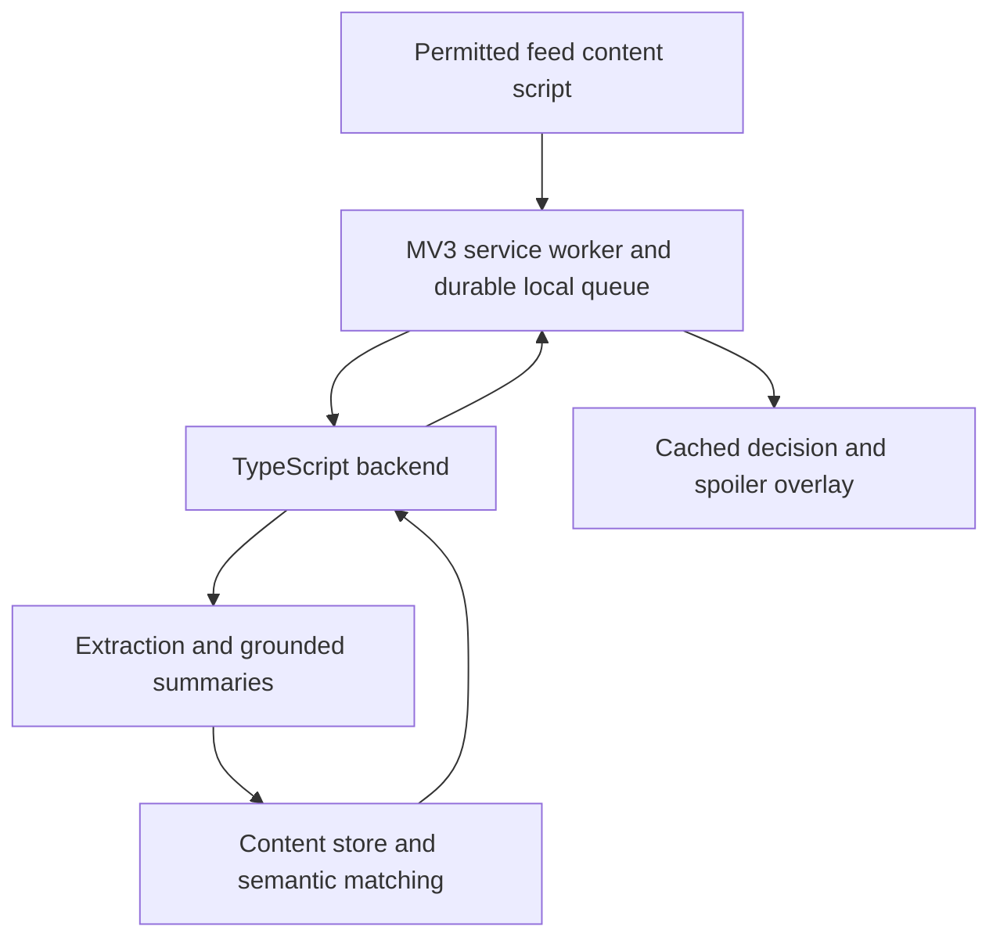

# SpoilerScroll design plan

> **Superseded (October 16, 2026).** SpoilerScroll is now an extension-only browser-history lookup: post titles are compared word-for-word with Chrome history titles within a chosen time range, and matching history URLs are shown before you click. See the [README](../README.md). The backend, dwell capture and claim matching described below were removed. This document is kept as the original hackathon design.

## Product

“Social media makes the next post feel new. SpoilerScroll remembers what you have already consumed and spoils repetitive content before you click.”

Build a Chrome extension that recognizes repeated information during sustained feed browsing, then offers a grounded spoiler. The user always controls whether to keep reading. Treat browsing patterns as signals, not a psychological diagnosis.

The user's direction establishes Chrome and content summaries. The specific site, thresholds, stack, and visual choices below are proposals.

## MVP scope

- One text-heavy public feed: Reddit proposed, with a controlled local feed using the same extraction interface for a reliable demo.
- Explicit enablement per supported site; pause and clear-history controls.
- Visible-content extraction, brief summaries, claim-level repetition matching, and a click-time spoiler.
- The backend stores qualified views and uses them as the history for repetition matching.
- Extraction uses the visible DOM preview; no external crawler.

Defer video/audio understanding, universal site support, accounts, a dedicated analytics dashboard, and remote full-text extraction.

## User journey and surfaces

1. Open the extension popup. Explain supported-site monitoring, remote processing, and stored data before enabling it.
2. Browse normally. Cards qualify as viewed only after meaningful visible dwell in an active tab. Visibility is a proxy for exposure, not proof of reading.
3. Extract and summarize qualified content once. Prepare nearby candidate cards in the background with bounded concurrency; do not count previews as consumed.
4. Compare a candidate's claims with previously viewed items and evaluate the browsing sequence.
5. A qualifying card receives a subtle “Similar to 3 posts you viewed” badge. On a normal click, show a compact spoiler anchored to that card.
6. Offer “Skip this,” “Read anyway,” and “This adds something new.” Include “Pause spoilers” and an expandable explanation with prior sources.
7. Popup shows observed repeats, explicit skips, and read-anyway actions for the session.

Illustrative overlay, only when supported by extracted evidence:

> Similar to 3 posts you viewed
>
> Spoiler: This preview repeats the claim that AI will change programming tasks. We could only read the preview.
>
> [Skip this] [Read anyway] [This adds something new]
>
> Why this appeared · Pause spoilers

“Skip this” closes the overlay without navigation. “Read anyway” follows the original destination once, without retriggering. An unclassified click navigates normally. Preserve modified clicks, middle clicks, downloads, and new-tab intent in the MVP; interception coverage is limited to tested normal activations, including keyboard activation.

### Visual direction

A calm, compact utility: warm neutral background, charcoal text, muted amber repetition indicator, teal primary action. Avoid alarming scores or guilt language. Use system typography and generous spacing. Scope overlay styles with Shadow DOM. Support visible keyboard focus, Escape dismissal, focus restoration, screen readers, and reduced motion. Avoid moving the page layout. Popup fits approximately 360px width; overlay remains usable in narrow windows.

## Detection and grounding

Initial tunable hypotheses, not validated behavioral thresholds:

| Signal | Proposed starting rule |
| --- | --- |
| Viewed item | At least 50% visible for 3 seconds while tab is active |
| Session boundary | 10 minutes without activity |
| Repeated information | At least 3 prior viewed items with overlapping claims in a 15-minute window |
| Sustained browsing | At least 5 active minutes plus repeated feed progression |
| Intervention frequency | At most once per item, 60-second cooldown |

Require both a browsing-pattern gate and sufficiently supported claim repetition. Topic similarity retrieves candidates; it does not by itself justify an intervention. New facts, dates, evidence, or opposing conclusions reduce repetition confidence. Tune similarity cutoffs using labeled fixtures before choosing numerical scores. The demo may explicitly enable a labeled short-session mode rather than silently changing these thresholds.

Summaries contain source ID, extracted evidence spans, main claims, extraction scope (preview/full text), and model version. Do not claim that an article adds nothing when only its preview is available. A preview-only match uses preview-only wording. Missing evidence, uncertain extraction, and incomplete classification produce no spoiler.

Never wait on a crawler or LLM inside the click handler. Cache prepared decisions; stale responses must not attach to recycled feed cards. Treat extracted content as untrusted data rather than model instructions.

## Architecture

Proposed stack: TypeScript throughout, Manifest V3 extension bundled with Vite, small Node backend, SQLite for hackathon content records, and backend LLM summarization/embeddings. Keep provider choice configurable. React is optional for the popup; it is unnecessary for feed observation.

The content script observes permitted DOM via IntersectionObserver and MutationObserver, deduplicates stable card IDs, and extracts through a site adapter. The service worker coordinates messages and persists queues/cache in extension storage so suspension does not lose work. The backend owns credentials, extraction validation, similarity, and view history. No model credentials ship in the extension.

## Data boundaries

| Store | Contents |
| --- | --- |
| Extension local storage | Opt-in sites, sensitivity, install UUID, pending events, recent decision cache |
| Backend content store | Content ID, canonical public URL, scoped evidence, full summary, claims, embeddings, extraction provenance |

## Privacy and failure behavior

Request site-scoped optional permissions and remote-processing consent. Exclude private messages, account/settings pages, incognito, and unapproved sites. Strip tracking parameters and retain only required public content. Implement pause immediately; clearing history clears local/backend records.

| Failure | Behavior |
| --- | --- |
| Summary or match still pending | Navigate normally |
| DOM adapter cannot extract | No spoiler |
| Provider timeout or invalid evidence | No invented summary; record failed attempt |
| History lookup fails | No spoiler; report detection unavailable |
| New evidence on same topic | Suppress spoiler or accept user correction |

## Implementation sequence and acceptance

1. **Extension foundation:** load unpacked, enable a supported site, observe qualified exposures, persist across worker restarts, pause successfully. Build controlled feed fixtures with repeated claims and genuinely new evidence.
2. **Content pipeline:** extract preview/full-text scope, produce grounded summaries, persist content and agent provenance, match claims. Prove that same-topic/new-information fixtures do not trigger.
3. **Intervention UI:** implement badge, cached click decision, spoiler, skip/read-anyway/feedback, cooldown and accessible focus handling.
4. **Demo validation:** exercise real feed where practical, fallback feed, network failures, stale DOM updates, and service-worker suspension. Verify no credentials in extension assets.

Suggested repository layout: `extension/`, `server/`, `demo/`, `shared/`, `docs/`. Tests should focus on dwell qualification, deduplication, new-evidence suppression, evidence grounding, and preserving navigation.

## Demo and measurement

Demonstrate three already-viewed items with shared claims, a candidate with the same claims, and another item containing new evidence. Show the repetitive candidate's spoiler and successful read-anyway behavior; leave the new-evidence item alone.

Measure qualified exposures, interventions, explicit skips, read-anyway rate, and false-positive feedback. “Skipped after spoiler” is observed behavior; it does not prove a click was avoided. Omit time-saved claims until a baseline or experiment supports them.

## Open choices and first build step

Proposed defaults are Reddit plus a local demo feed and a TypeScript/Node stack.

## Sources checked

- [Chrome content scripts](https://developer.chrome.com/docs/extensions/develop/concepts/content-scripts)
